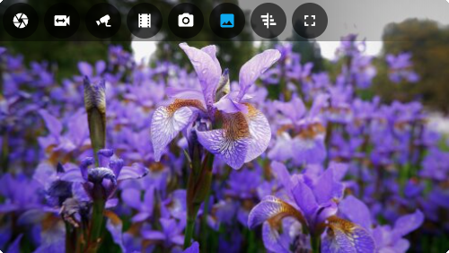

<!-- markdownlint-disable first-line-heading -->
<!-- markdownlint-disable fenced-code-language -->
<!-- markdownlint-disable no-inline-html -->

# Advanced Camera Card

Formerly known as: `Frigate Card`

A comprehensive camera card for Home Assistant.

- Live viewing of multiple cameras.
- Clips, snapshot and review browsing via mini-gallery.
- Automatic updating to continually show latest clip / snapshot.
- Support for filtering events by zone and label.
- Arbitrary entity access via menu (e.g. motion sensor access).
- Fullscreen mode.
- Grid or carousel/swipeable media, thumbnails and cameras.
- Direct media downloads.
- Lovelace visual editing.
- Full [Picture Elements](https://www.home-assistant.io/dashboards/picture-elements/) support.
- Theme friendly.

See [full documentation](https://dermotduffy.github.io/advanced-camera-card).

## DVRKit fork builds and releases

The `dvrkit-engine` branch is checked on pushes and pull requests. CI runs the
code, HACS, coverage, Chromium browser, built-card, and distribution
compatibility checks. It does not connect to a DVR or deploy to Home Assistant.
The CI workflow can also be started manually for a branch.

To publish a DVRKit prerelease, push a tag such as `v8.1.0-dvrkit.2` to
`ofa1/advanced-camera-card`. The version embedded in the build omits the leading
`v`. Publication waits for all checks in that tag's workflow run. The release
contains `advanced-camera-card.zip` with the complete distribution at its root,
as well as every JavaScript file separately. When installing manually, keep all
of the files together so dynamically loaded chunks remain available. The
inherited upstream release automation is restricted to the upstream repository.
